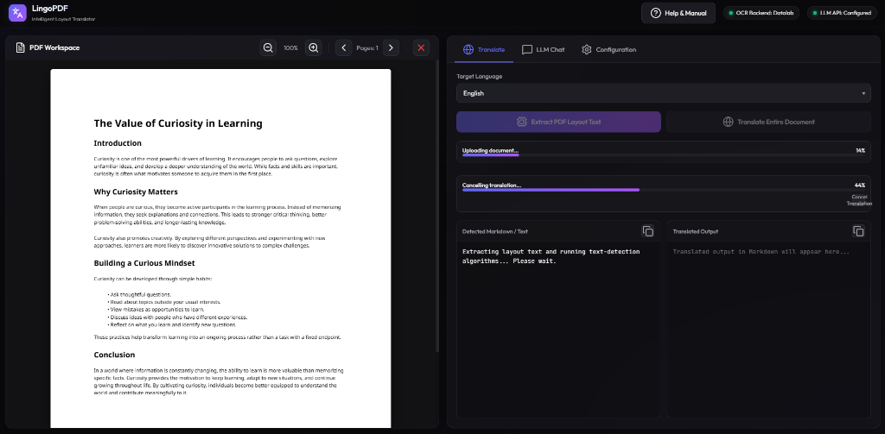

# PDF Translate Studio (LingoPDF)

PDF Translate Studio (LingoPDF) is a premium, layout-aware translation application designed to process complex documents (including images, mathematical equations, and tables) while preserving their original structure. Powered by FastAPI on the backend and a glassmorphic dashboard on the frontend, LingoPDF connects to Ollama, OpenAI, Gemini, Claude, DeepSeek, and any custom OpenAI-compatible API to deliver high-fidelity translations.



---

## 🚀 Key Features

*   **Layout-Aware Document Processing**:
    *   **Datalab API (Cloud)**: Instantly uploads and parses layouts in the cloud without taxing local resources.
    *   **Marker (Local)**: Runs Surya layout algorithms offline.
    *   **PyMuPDF (Fallback)**: Seamless out-of-the-box fallback translation.
*   **Dual-Pane Translation interface**: Interactive side-by-side view with PDF canvas rendering, selection tooltips, and real-time Markdown output.
*   **Custom LLM Provider Manager**: Dynamically add and manage custom endpoints (such as OpenRouter, Groq, Together AI, NVIDIA NIM, or local vLLM/LM Studio instances) directly from the interface.
*   **Dynamic Online Model Retrieval**: Queries providers' APIs on-the-fly to pull the latest active models, eliminating hardcoded dropdown lists.
*   **Credential Connection Tester**: Quickly test network and authorization settings before translating documents.
*   **Paragraph-Preserving Chunking & Rate Limiting**:
    *   **Semantic Chunker**: Automatically splits text by paragraphs (`\n\n`) to stay under context limits without breaking lists, code blocks, or markdown tables.
    *   **Delay Interval**: Adjustable request delays to prevent token/request rate limits (RPM/TPM).
    *   **Progress Indicators**: Shows real-time progress bars and offers a **Cancel Translation** button.
*   **Proxy Routing**: Connect to cloud APIs securely via SOCKS5, SOCKS4, and HTTP/HTTPS proxies (default: `127.0.0.1:1080`).
*   **Self-Correcting Launcher**: Booting `python run.py` automatically checks and runs inside the local `.venv`, bypassing execution policy limits and preventing `ModuleNotFoundErrors`.

---

## 🛠️ Getting Started

### 1. Prerequisites
Ensure you have Python 3.10+ and [uv](https://github.com/astral-sh/uv) (or pip) installed.

### 2. Installation
Clone the repository and install the dependencies:
```bash
git clone https://github.com/Majidi-star/pdf-translate-studio.git
cd pdf-translate-studio
uv venv
.venv\Scripts\pip install -r requirements.txt
```

### 3. Run the Server
Launch the application using:
```bash
python run.py
```
*Note: The launcher will automatically redirect execution to `.venv\Scripts\python.exe` and open the dashboard in your default browser at `http://127.0.0.1:8000`.*

---

## ⚙️ Configuration Guide

### Custom LLM Providers
1. In the **Configuration** tab under **LLM Translation Engine**, click the **Plus (+)** button.
2. Enter your custom provider's name (e.g., `Groq`) and its **API Base URL** (e.g., `https://api.groq.com/openai/v1`). Click **Save**.
3. Select the provider, input your API key, and click the **Test Connection** button to verify connection.
4. Click **Fetch Online Models** to dynamically load their active models list.

### Rate Limits & Context Safety
For large documents:
*   Adjust **Translation Chunk Size** to control prompt sizes (e.g., `2500` characters is ideal for smaller local models).
*   Add a **Request Delay** (e.g., `1.0` to `5.0` seconds) to avoid rate limits when translating multiple blocks.

---

## 📄 License
This project is licensed under the terms of the license file included in this repository.
